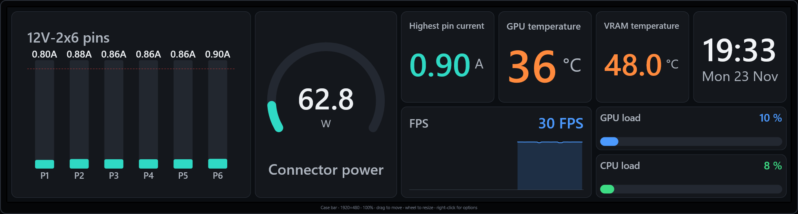
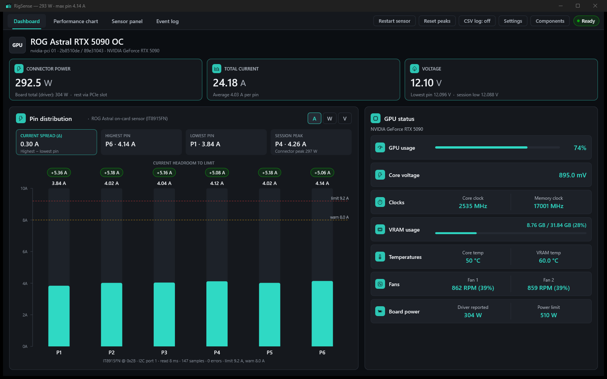
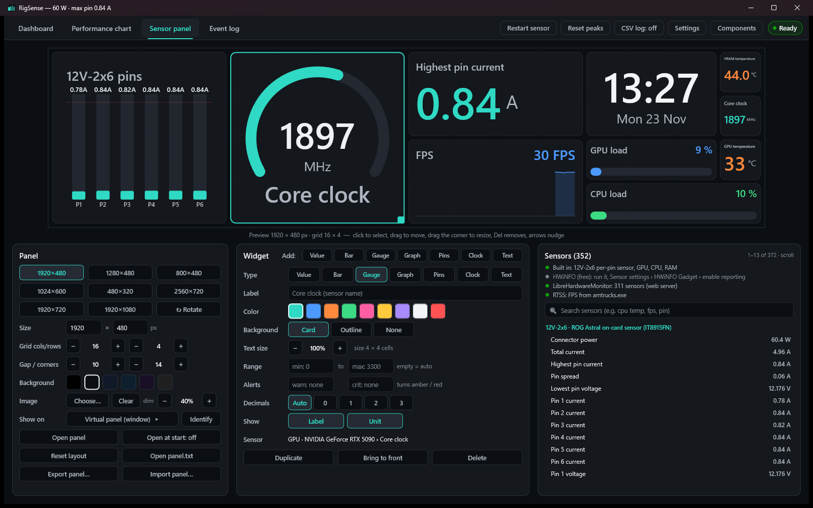
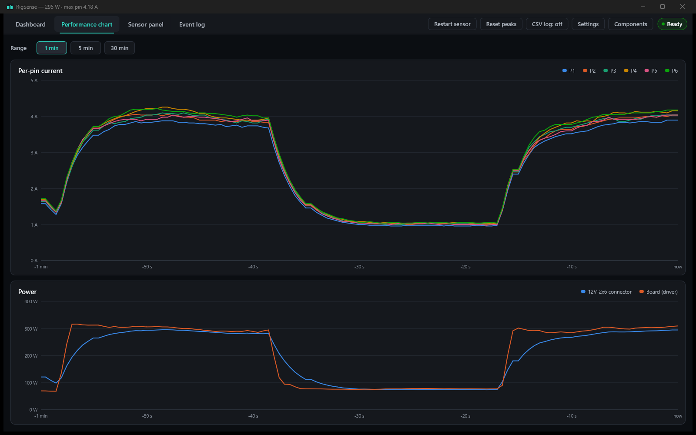
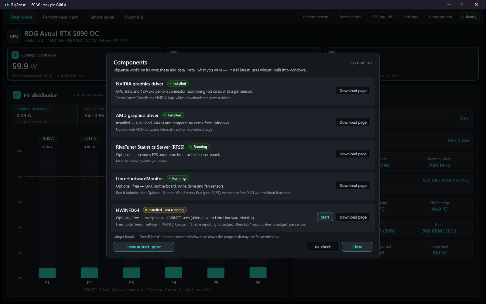
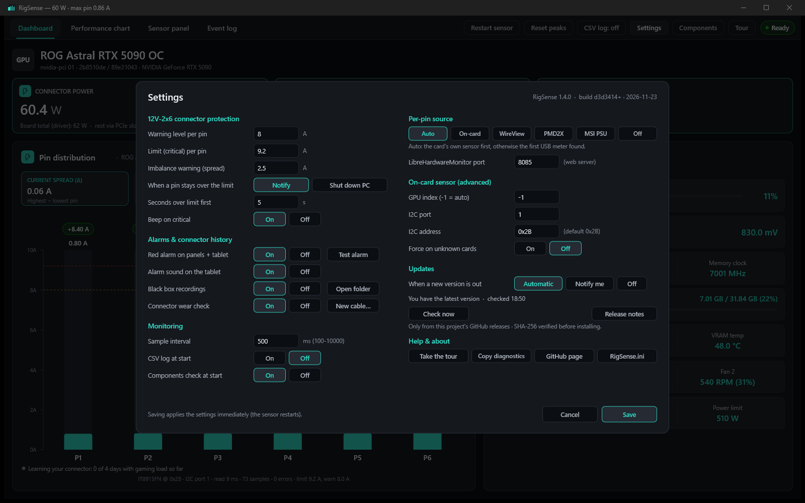
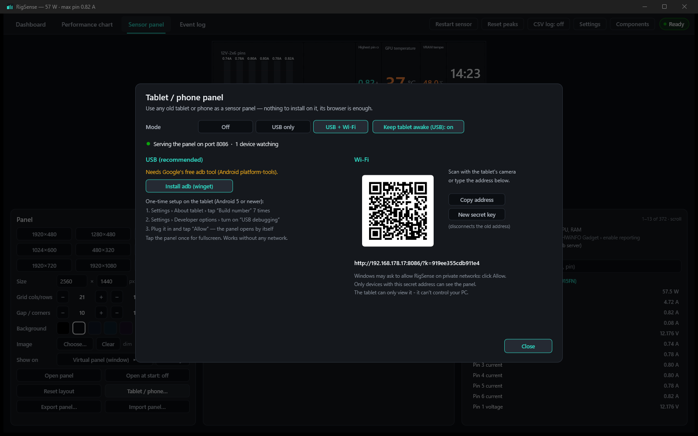

# RigSense

**A free, local hardware monitor and sensor-panel designer for Windows. It also watches the 12V-2x6 (12VHPWR) connector pin by pin, using a GPU with a per-pin sensor or a USB per-pin meter that works with any GPU.**

RigSense is a single small native app (C++, Win32 + Direct2D), not a web or Electron app. It sends no telemetry and doesn't need an account. You can design your own sensor panel for any case screen, or run it as a virtual panel on your desktop.



---

## Features

- **12V-2x6 per-pin monitoring for any GPU.** RigSense shows the current of every pin (plus voltage where the device measures it), total connector power, pin imbalance, and session peaks. It reads either the card's own sensor (ASUS ROG Astral) or an external USB meter (Thermal Grizzly WireView Pro II, ElmorLabs PMD2X, or an MSI MPG Ai1300TS/Ai1600TS power supply), so it also works on AMD and Intel cards.
- **Safety alerts.** You get a warning and a Windows notification when a pin goes over your warning or limit level, when the load becomes unbalanced, or when the sensor stops responding. Optionally, RigSense can start an **emergency shutdown** (a 60-second countdown you can cancel) if a pin stays over its limit.
- **Works with any GPU.** NVIDIA cards get full detail through NVML/NVAPI. AMD and Intel GPUs get load, VRAM, temperature, fan, power and memory clock from the same Windows interfaces Task Manager uses. When LibreHardwareMonitor runs, they also get core clock, hotspot, VRAM temperature, voltage and board power in watts.
- **Sensor panel designer.** Build a panel for any screen size (1920×480 bar, 800×480, 1024×600, portrait, or a custom size) with drag-and-drop widgets:
  - Value, Bar, Gauge, Graph, connector Pins, Clock and Text.
  - Per-widget colour, background style, text size, label, range, warning/critical levels, decimals, and graph history length.
  - Panel background colour or image, grid, spacing and corner radius.
- **Virtual panel.** No case screen yet? Open the panel as a floating "device" window at its real pixel size. Drag it around, scroll to resize, and pin it on top.
- **Real panel output, one size fits all.** Any panel that Windows sees as a monitor works (HDMI, DisplayPort or USB-C):
  - **Drag and drop:** drag the virtual panel onto your case display and let go. It goes fullscreen there and adopts that display's resolution. If the display's shape differs a lot from your design, the grid rescales and keeps your arrangement.
  - **Pick it directly:** choose the display under **Show on**. Monitors are listed by name and resolution, and **Identify** shows a big number on each screen.
  - **Set and forget:** if the case display is unplugged or switched off, the panel falls back to a window. When the display comes back, the panel returns to it fullscreen. Right-click the panel for *Back to window*, *Fullscreen on display…*, or to turn off snapping.
- **Export / import.** Share a finished panel as one `.rigpanel` file. The background image is included.
- **More sensors for free.** RigSense reads every CPU, motherboard, RAM, drive and fan sensor from **LibreHardwareMonitor** or **HWiNFO's free Gadget mode**. It does not use HWiNFO shared memory, which has a 12-hour limit in the free version. It also reads **FPS and frame time** from RTSS.
- **Component check.** RigSense detects your GPU driver, RTSS, LibreHardwareMonitor and HWiNFO, links each download page, and can install the latest version for you through `winget`.
- **Automatic updates.** When a new release is published, RigSense downloads it from this repository's GitHub releases, verifies its SHA-256 checksum, and restarts into the new version. It never restarts while a connector alert is active. You can switch this to *Notify me* or *Off*.
- **Settings window.** Change the connector protection, per-pin source, monitoring and update options in the app, with Save/Cancel. The version and build (git commit and date) are shown in Settings and in the exe's file properties.
- **Old tablet or phone as a panel.** Any Android tablet, phone or iPad can show your sensor panel through its own browser, with nothing to install on it. Use **USB** (no network needed, the tablet stays charged and awake) or **Wi-Fi** (scan a QR code). It's local, free and ad-free. See [below](#use-an-old-tablet-or-phone-as-a-panel).
- **Screen detection.** RigSense knows the resolution and aspect ratio (16:9, 21:9, 32:9, 16:10, 4:1…) of every display and of a connected tablet. **Detect screens** designs the panel for one of them in a click, and a rotated screen shows your design fitted instead of stretched.
- Performance chart, event log, CSV logging, and a tray icon with notifications.

| Dashboard | Sensor panel designer |
|---|---|
|  |  |
| **Performance chart** | **Component check** |
|  |  |

---

## Download & run

1. Go to [**Releases**](../../releases/latest) and download `RigSense-<version>-win64.zip`.
2. Extract it anywhere, for example `C:\Tools\RigSense`.
3. Run **`RigSense.exe`**. It needs no installer and no admin rights. Settings, layouts and logs stay in the same folder.

> Windows SmartScreen may warn because the exe isn't code-signed. Click **More info → Run anyway**, or build the exe yourself from the source (see below).

**Requirements:** Windows 10 (version 2004 or newer) or Windows 11, 64-bit, and a working GPU driver.

### GPU support

| | NVIDIA | AMD | Intel |
|---|---|---|---|
| Load, VRAM, temperature | ✅ (NVML) | ✅ (Windows counters) | ✅ (Windows counters) |
| Clocks, fans, power | ✅ core + memory clock, RPM + duty, watts | memory clock, RPM, % of power limit (+ core clock, watts via LibreHardwareMonitor) | memory clock, % of power limit (+ core clock, watts via LibreHardwareMonitor) |
| Core voltage, hotspot, VRAM temperature | ✅ | via LibreHardwareMonitor (merged into the GPU panel automatically) | via LibreHardwareMonitor |
| 12V-2x6 per-pin | ✅ ASUS ROG Astral on-card sensor*, or any meter below | any meter below | any meter below |

\*Known subsystem IDs: `1043:89E3`, `89EA`, `8A61`, `89EC`, `89ED`, `89DE`, `8A2E`, `8A2B`, `8A45`. Verified on a ROG Astral RTX 5090 OC (`89E3`). Other Astral cards can try `Force=1` in the settings. The sensor is only read, never written to.

### Per-pin sources

| Source | Pins | Connection | Status |
|---|---|---|---|
| ASUS ROG Astral on-card sensor (IT8915FN) | 6 × V + A | GPU I²C via NVAPI | ✅ verified on hardware |
| [Thermal Grizzly WireView Pro II](https://www.thermal-grizzly.com/en/wireview-pro-ii-gpu/s-tg-wv-p2-h19n) | 6 × V + A, connector temperatures, device fault flags | USB (serial) | 🧪 experimental: built from the [community protocol notes](https://github.com/Gustav0ar/wireview-pro-ii), testers wanted |
| ElmorLabs PMD2X | 6 × V + A, EPS/PCIe/board power | USB (serial) | 🧪 experimental: built from [ElmorLabs' sample code](https://github.com/ElmorLabs/PMD2-Python), testers wanted |
| MSI MPG Ai1300TS / Ai1600TS (GPU Safeguard+) | 6 A (12 with two connectors), PSU 12 V rail, power, temperature | USB (HID, internal header) | 🧪 experimental: built from the [community protocol notes](https://github.com/boboom66/msi-psu-monitor), testers wanted |

RigSense picks the card's own sensor first, then the first meter it finds (`PinSource=` in the settings forces a specific one). Only the devices' documented **read** commands are sent, never the ones that change settings or thresholds. A USB-serial device must first identify itself as a WireView or ElmorLabs meter before RigSense sends it anything. Close the vendor app (WireView software, MSI Center) if it holds the device. If a meter that was working disappears, that's treated as **sensor lost**, a critical alert.

### Optional extra sensors (all free)

| Tool | What it adds | Setup |
|---|---|---|
| [LibreHardwareMonitor](https://github.com/LibreHardwareMonitor/LibreHardwareMonitor/releases/latest) | CPU, motherboard, RAM, drives, fans, and extra AMD/Intel GPU detail | Run it (it asks for admin rights), then turn on **Options → Remote Web Server → Run** (port 8085). Version 0.9.5 and newer only share data that way. Older versions (WMI) need no extra step. Tip: restrict the web server to this PC if your version offers that, because by default other devices on your network can reach it. |
| [HWiNFO64](https://www.hwinfo.com/download/) | Every HWiNFO sensor | *Sensor settings → HWiNFO Gadget →* enable reporting, then tick **Report value in Gadget** for each sensor you want. |
| [RTSS](https://www.guru3d.com/download/rtss-rivatuner-statistics-server-download/) | FPS and frame time | Keep it running while you play. |

The **Components** button (also shown at start-up when something is missing) checks all of these and can install them with `winget`.

---

## Using the sensor panel

1. Open the **Sensor panel** tab and pick your screen size (or type a custom one).
2. Click **Add** to add widgets, or click a sensor in the list on the right. Drag a widget to move it and drag its corner to resize. **Del** removes it and the arrow keys nudge it.
3. Select a widget to change its type, colour, background, text size, label, range, alert levels and so on.
4. Click **Open panel**. To put it on your case display, either drag the virtual panel onto that display, or pick the display under **Show on** (**Identify** helps you tell screens apart). Turn on **Open at start** so the panel opens automatically with RigSense and follows the display when it's plugged back in.
5. **Export panel…** saves a `.rigpanel` file you can share. **Import panel…** loads one.

Sensors from HWiNFO and LibreHardwareMonitor are tied to the hardware, so an imported panel tells you which widgets need a sensor picked on your PC.

---

## Safety

The per-pin view exists to catch a failing 12V-2x6 connection early: one pin carrying much more current than the others, or a pin going over its rating.

- **Warning** at `WarnA` (default 8.0 A per pin), **critical** at `LimitA` (default 9.2 A). Both raise a beep and a Windows notification.
- **Imbalance warning** when the spread between the highest and lowest pin exceeds `SpreadWarnA` (default 2.5 A).
- **Sensor lost** raises a critical notification, because no data means no protection.
- `CriticalAction=shutdown` starts a 60-second Windows shutdown if a pin stays over the limit for `CriticalSeconds`. Cancel it with `shutdown /a`.

> RigSense is a monitoring aid and doesn't replace a correctly seated, undamaged cable. It comes with no warranty (see the license). If you see high or unbalanced pin currents, power down and check the connector.

---

## Settings

Click **Settings** in the app. Everything below can be changed there, and **Save** applies it immediately. The values are stored in `RigSense.ini` next to the exe. *Open RigSense.ini (advanced)* in the Settings window opens the file itself.



| Key | Default | Meaning |
|---|---|---|
| `PollMs` | 500 | Sample interval in milliseconds |
| `LimitA` / `WarnA` | 9.2 / 8.0 | Per-pin critical and warning current, in amps |
| `SpreadWarnA` | 2.5 | Imbalance warning level, in amps |
| `Beep` | 1 | Beep on critical |
| `CriticalAction` | notify | `notify` or `shutdown` |
| `CriticalSeconds` | 5 | Seconds over the limit before the critical action runs |
| `Csv` | 0 | Start with CSV logging on (files go to `logs\`) |
| `PinSource` | auto | `auto` (card sensor, else the first meter found), `astral`, `wireview`, `pmd2x`, `msipsu` or `off` |
| `LhmPort` | 8085 | LibreHardwareMonitor web server port |
| `GpuIndex`, `I2CPort`, `I2CAddr`, `Force` | -1, 1, 0x2B, 0 | Advanced options for the on-card sensor |
| `[Updates] Mode` | auto | `auto` (download, verify, install and restart), `notify` (tell me, I click Install), or `off` |

### Updates & privacy

RigSense checks `api.github.com` for a newer release 20 seconds after starting and then every 6 hours. The request carries only a `RigSense/<version>` user agent, and nothing about your PC is sent. Updates are downloaded only from GitHub hosts over HTTPS. The new `RigSense.exe` must match the SHA-256 in the release's `SHA256SUMS.txt` before it's installed. The old exe is kept as `RigSense.exe.old` until the next start. If RigSense lives in a folder you can't write to (e.g. Program Files), you'll get a notification instead.

---

## Build from source

You need the Visual Studio 2022 Build Tools (C++ workload) and a Windows 10/11 SDK. The project has no third-party dependencies.

```bat
build.bat              :: builds bin\RigSense.exe and bin\rigsense-cli.exe
tests\run_tests.bat    :: meter decoders, updater, layout / export / import / fuzz tests
```

`rigsense-cli.exe` is a console tool. `rigsense-cli -n 0` streams the on-card per-pin readings, `rigsense-cli --meters` finds and reads an external per-pin meter, and `rigsense-cli --sensors` lists every sensor RigSense can see.

If you own a WireView Pro II, PMD2X or MSI Ai1300TS/Ai1600TS, please run `rigsense-cli --meters` and open an issue with the output (working or not). That's how these sources move from experimental to verified.

**Releasing (maintainers):** bump the numbers in `src/version.h`, build, then publish a GitHub release tagged `vX.Y.Z` with these assets: `RigSense.exe`, `rigsense-cli.exe`, `SHA256SUMS.txt` (`<sha256>  <file name>` per line), and the zip. Installed copies pick it up automatically.

### How the per-pin sensor is read

ROG Astral cards have an ITE IT8915FN chip on the GPU's own I²C bus. RigSense reads it with `NvAPI_I2CReadEx` (port 1, address `0x2B`, registers `0x80`–`0x97`, one byte at a time). Each pin takes 4 bytes: big-endian millivolts followed by big-endian milliamps, and the pins come back in reverse order. A reading is accepted only if every pin shows 6–13 V. The register map was worked out by the community; thanks to [astral-hwmon](https://github.com/ksokolowski/astral-hwmon), [astral-power-monitor](https://github.com/EthDevOps/astral-power-monitor), [LACT #906](https://github.com/ilya-zlobintsev/LACT/issues/906) and [LibreHardwareMonitor #1830](https://github.com/LibreHardwareMonitor/LibreHardwareMonitor/issues/1830).

---

## Reporting bugs & ideas

Open an [issue](../../issues/new/choose) and pick a form: **Bug report**, **Per-pin meter test report** (WireView Pro II / PMD2X / MSI PSU owners, please!) or **Feature request**. Report security problems privately via [Report a vulnerability](../../security/advisories/new).

New issues get an automatic first look: an AI assistant (Claude) checks the report against the code, labels it, and replies with what it found or which details are missing. For confirmed bugs it may propose a fix as a pull request. Nothing is merged without the maintainer's review. Every pull request is compiled and tested automatically on Windows ("Build & test" workflow), and its build can be downloaded from the run's artifacts, so you can try a fix before it's released.

---

## Use an old tablet or phone as a panel

Got an old Android tablet or phone, or an iPad, lying around? It can be your sensor panel. RigSense draws the panel at the device's exact resolution and the device's browser shows it fullscreen. Nothing needs to be installed on the device, and there are no ads or accounts.



Open **Sensor panel → Tablet / phone…** and pick a mode:

| | **USB** (recommended for a tablet mounted on or next to your case) | **Wi-Fi** |
|---|---|---|
| How | RigSense connects with Google's free `adb` tool (install it from the dialog or the Components check) and opens the panel on the tablet automatically | Scan the QR code with the tablet, or type the address |
| Network | None. The tablet reaches RigSense through the cable only | Same home network. The address contains a secret key, so other devices can't view the panel |
| Screen stays on | Yes, while plugged in (RigSense can keep it awake) | Use the tablet's own screen-timeout or "stay awake" setting |
| Works with | Android 5 or newer | Android, iPad/iPhone, anything with a browser |

**One-time USB setup on the tablet:** *Settings → About tablet →* tap **Build number** 7 times, then *Settings → Developer options →* turn on **USB debugging**. Plug the tablet in and tap **Allow**, and the panel opens. Tap it once for fullscreen. In Chrome, *Add to Home screen* gives you an app-like icon.

The tablet can only **view** the panel; it can't control your PC. The panel updates twice per second while a device is watching and stops rendering when nobody is (frames are about 50–100 KB). When the device is rotated relative to your design, the design is shown fitted. **Design for this tablet** in the dialog, or **Detect screens** in the editor, makes a layout that fills the device exactly.

Settings (`[Tablet]` in `RigSense.ini`): `Mode` = `off` / `usb` / `wifi` (USB + Wi-Fi), `Port` = 8086, `Key` (the secret; **New secret key** in the dialog replaces it), `StayOn` = 1.

---

## Changelog

**1.3.0**
- **Tablet / phone panel:** RigSense serves the panel to any browser, over USB (`adb reverse`, no network) or Wi-Fi (QR code, secret key). It renders at the device's exact resolution, works on old Android and iOS browsers, has a fullscreen home-screen shortcut, and can keep the screen awake over USB. Read-only, and off by default.
- **Screen detection:** aspect ratio labels (16:9, 21:9, 32:9, 16:10, 4:1…) for the design, displays and Identify. **Detect screens** designs the panel for a connected display or tablet. The Tablet dialog suggests *Design for this tablet* when the shapes differ.
- A rotated display or tablet now shows the design fitted (letterboxed) instead of stretched.
- Optional "Android platform-tools (adb)" row in the Components check.


**1.2.0**
- Automatic updates from GitHub releases, SHA-256 verified, with Automatic / Notify me / Off modes. Updates never apply while a connector alert is active.
- New in-app Settings window, replacing editing the INI in Notepad.
- Version and build (git commit + date) shown in Settings, the Components dialog and the exe's file properties.
- Drag the virtual panel onto any display and it goes fullscreen there. A right-click menu offers *Back to window*, *Fullscreen on display…*, and turning snapping on or off.
- The display picker shows monitor names and resolutions, and **Identify** shows a number on each screen.
- The panel follows its display automatically: it falls back to a window when the display disconnects and returns to it when it reconnects.
- When the target display has a different shape, the grid rescales proportionally instead of stretching the widgets.

**1.1.0**
- Per-pin monitoring for any GPU through external meters: Thermal Grizzly WireView Pro II, ElmorLabs PMD2X, and MSI MPG Ai1300TS/Ai1600TS (GPU Safeguard+, including a second connector). They share all the alerts and the emergency shutdown. WireView device faults raise critical alerts.
- LibreHardwareMonitor 0.9.5+ support through its web server (0.9.5 removed WMI). WMI still works for older versions.
- AMD/Intel GPUs: LibreHardwareMonitor values (core clock, hotspot, VRAM temperature, voltage, board watts, fan duty) are merged into the standard GPU sensors and the dashboard.
- Clearer messages when no per-pin source exists. Meter decoder unit tests.

**1.0.0**: first release.

## License

[MIT](LICENSE). Includes the [QR Code generator library](https://github.com/nayuki/QR-Code-generator) by Project Nayuki (MIT), in `src/third_party/qrcodegen`. RigSense is not affiliated with ASUS, NVIDIA, AMD, Intel, REALiX (HWiNFO), Guru3D (RTSS) or the LibreHardwareMonitor project. All trademarks belong to their owners.
